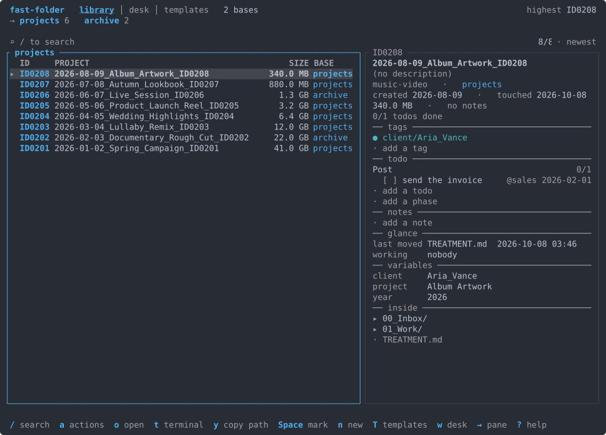
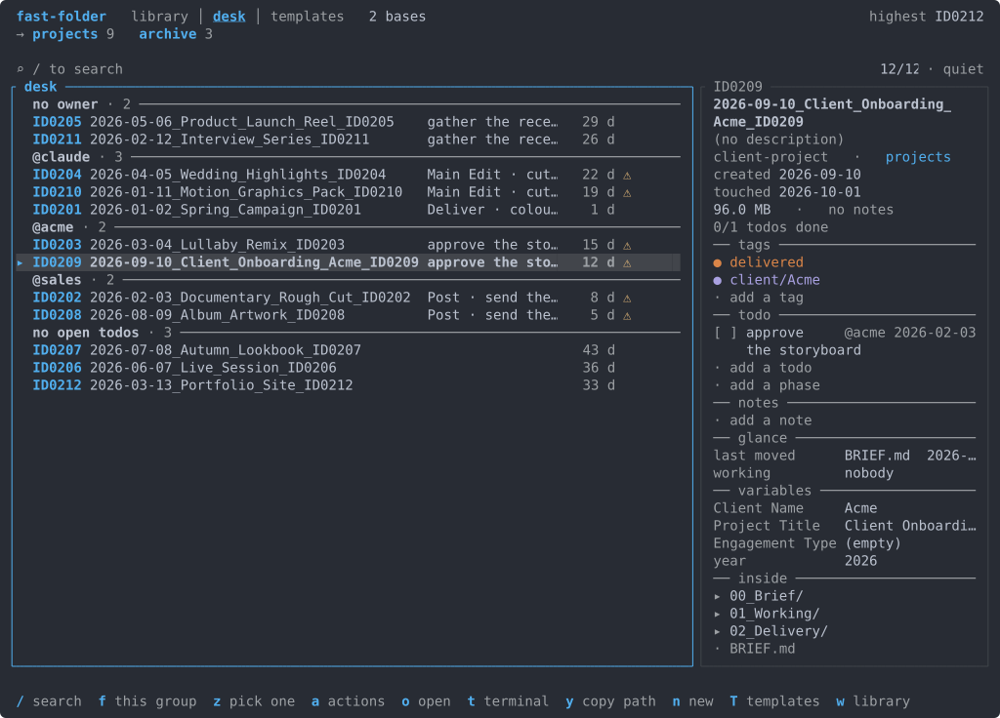
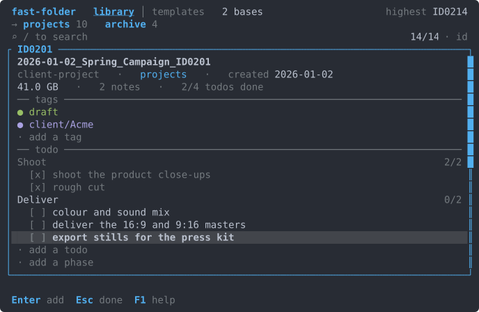

<h1 align="center">fast-folder</h1>

<p align="center"><b>Project folders made from templates, created and managed from your terminal. Start a project in seconds, then find, open, move and organize any of them with a keystroke. Every project is numbered across all your drives, and one screen shows who the next todo of each project is assigned to.</b></p>

<p align="center">
  <a href="https://github.com/cristocola/fast-folder/actions/workflows/ci.yml"></a>
  <a href="https://github.com/cristocola/fast-folder/releases"></a>
  <a href="https://aur.archlinux.org/packages/fast-folder"></a>
  <a href="LICENSE"></a>
  <a href="https://www.rust-lang.org/"></a>
</p>

If you work with many projects and many clients, you end up managing a lot of folders and files. fast-folder gives you one place to create them and one place to find, open, move and copy them afterwards.

You describe a folder structure once as a template. Every project you make from it comes out the same way: a consistent name, the subfolders you always need, starter files with your answers already written inside them, a unique ID, and a small metadata file that lets you find the project again months later.

Day to day you work in a full screen terminal app that shows your whole library at once and acts on it. Everything the app can do also has a command, so the same work fits into a script, a cron job, or a hotkey on your desktop. The command is `fastf`.

When other people or programs do the work inside the projects (an agent in one folder, a colleague in the next, a client who still has to answer), fast-folder shows you the state of all of them on one screen called the desk. It lists every project as one line with its next open todo, who that todo is assigned to, how long the project has been quiet, and which programs are working in its folder right now. Nothing is stored for this and nothing is guessed. It is all read from the folders.

<p align="center"></p>

## Quick start

```bash
# Any Linux: downloads the binary and puts it on your PATH
curl -fsSL https://raw.githubusercontent.com/cristocola/fast-folder/main/packaging/linux/install.sh | sh

# Arch Linux
paru -S fast-folder-bin

# Windows installer
https://github.com/cristocola/fast-folder/releases

# Your first project
fastf                        # pick a template, fill the form, done
```

Two templates are installed on first run. `general` is ready to use straight away and gives you a dated, numbered folder with an inbox inside it. `client-project` adds working and delivery folders plus a brief that fills itself in with the client's name and the project details.

More templates for specific kinds of work live in the [`examples/templates/`](examples/templates/) gallery: `music-video`, `photography`, `video-production`, `rust-project`, `python-project`, `web-project`, `finance-monthly` and `research-note`. Copy any folder into your own templates directory to adopt it, then edit it to match how you work.

## What it does

The long list. Every item is something you can do today, and each links to the guide that explains it.

### Creating

* **Creates a whole project from a template.** One template describes the folder tree and the starter files. You answer a few questions and fast-folder makes the folder, the subfolders, and files with your answers written into them: a brief with the client's name in it, a shot list titled for the artist, a report header with the right month, a config ready to build. Text files get their placeholders filled in. Binary files such as a logo or a video asset are copied byte for byte.
* **Numbers every project, across all your drives.** One counter hands out IDs (`ID0047`, `ID0048`), and every drive that holds projects carries a copy of it, so a machine that boots two operating systems, a USB stick and a network share all continue the same count. A preview and its commit always agree on the next number. Losing a counter file is untidy, not harmful, because the projects themselves say how high it got.
* **Asks everything on one screen.** Creating a project, adopting a folder and applying a template all use one form in the app: every question on one screen, a preview of the folders and files it would make, and Enter. A refused answer names its field and keeps what you typed.
* **Runs your own steps after creating a project.** It can open the new folder, start your editor, initialize a git repository, or run any command you give it, for one template or for every template. [docs/templates.md](docs/templates.md#post-create-actions)
* **Reads a template out of a finished project.** `fastf template from-folder` looks at a project you are happy with and writes the template that would produce it. The app's templates tab has a builder with an explanation panel and a guide of seven pages. [docs/templates.md](docs/templates.md)
* **Adopts folders you already have.** `fastf register` writes the metadata file into a folder that came from somewhere else, one folder at a time or a whole directory at once, and keeps an ID it finds in the folder's name. `fastf apply` adds a template's missing folders and files to a folder that already exists, and never overwrites anything. [docs/cli.md](docs/cli.md#registering-existing-folders)

### Finding

* **Finds any project again.** Every project carries a unique ID, a creation date, tags and searchable metadata. `fastf open ID0047` opens the folder, and so does `fastf open 47` or `fastf open lullaby`. In the terminal app the list narrows as you type, matching a name, an ID, a template or a tag, and a typo still finds the project. Exact filters work in both places: `fastf search template=music-video tag:draft created>2026-01-01`. [docs/cli.md](docs/cli.md#search)
* **Sorts every way, in both directions.** Newest, oldest, name, id, template, base, size. Every order except the dates also runs reversed, so the smallest folder or the highest ID is one key away. You can filter by template, by base and by tag, mark rows for a batch, and use the bases panel to keep an archive out of the daily list and bring it back with one key.
* **Opens projects in the tools you already use.** Reveal a folder in your file manager, open a terminal inside it, put its path on the clipboard, or print the path on stdout for `cd "$(fastf path api)"`. Bind fast-folder to a hotkey on your desktop and it opens a terminal for itself when a question needs an answer. [docs/cli.md](docs/cli.md#browsing-projects)
* **Tells you what a project is without opening it.** One line of description is shown in every list. `fastf show` prints everything fastf knows about a project. `fastf peek` prints a short summary: the next open todo and who it is assigned to, how many todos are open and done, which programs are working in the folder, the newest file under it, the repository's branch and last commit, the last note, and how long the project has been quiet. [docs/cli.md](docs/cli.md#peek)

### Overseeing

* **The desk: every project on one line, grouped by who its next todo is assigned to.** `w` in the app or `fastf desk` lists every project as one line under a heading for its assignee: *yours*, *@claude*, *@acme*, *no owner* when the next todo has no owner, and *no open todos* when the project has none left. Each line shows the next open todo, how long the project has been quiet, `active` when a program is working in its folder right now, and a warning when a todo assigned to someone has waited for days with nothing written and nobody working. The project that has been quiet the longest comes first within each group. One key shows a single group, changes the order, or picks a project at random. There are no due dates, no priorities and no status to maintain: the owner is on the todo's line and the age is the folder's own time. [docs/app.md](docs/app.md#the-desk)
* **Todos with owners and dates.** A todo's line may end in `@owner added:<when> done:<when>`. fastf writes these when you add, assign or tick a todo, and any person or agent reading the raw file can read them. The pane shows the owner and the day at the right of the row. `O` changes the owner; `fastf todo owner` does the same from a script. A todo nobody dated or assigned stays exactly as it was. [docs/projects.md](docs/projects.md#project_infomd)
* **The hat.** `fastf hat sales` tells fastf that `@sales` is you: the desk lists the todos assigned to that name under *yours*, the header shows it, `todo add --mine` assigns new todos to it, and `FASTF_HAT` sets a different one for a single terminal. [docs/cli.md](docs/cli.md#the-hat)
* **Agents, without a runner.** Set `agent = "claude"` once and `fastf agent lullaby` starts it in that project's folder, in the terminal you are in. From a desktop launcher it opens a window of its own. In the app, `x` opens a window per agent so the desk stays up, and `X` runs it in the app's own terminal. fastf keeps no list of agents and polls no process: what the agent ticked, noted and changed is in the folder, and the desk reads it from there. [docs/cli.md](docs/cli.md#starting-the-agent-there)
* **What happened while you were not looking.** `fastf journal` lists every dated note across every project, newest first, and `--todos` adds every todo that was ticked (with `--todos=all`, every todo that was added too). In the app, the journal page under `L` draws a line where the desk was last open, so everything that happened since then is above the line. [docs/cli.md](docs/cli.md#journal)

### Keeping records

* **Keeps a record of each project.** Tags group projects across templates and bases. Every project keeps dated notes, as many lines as a note needs, and a todo list grouped into phases such as shoot, edit and deliver. Both are plain Markdown in the project's `PROJECT_INFO.md`, so any editor can change them, and the app shows the change within a second. A template can give every new project the checklist its kind of work always starts with. [docs/projects.md](docs/projects.md)
* **The pane is an editor you step into.** `→` puts the cursor among the project's tags, todos, notes and variables, read from the file as it is on disk. Enter acts, F2 edits, `+` adds, and those three keys mean the same on every screen. A todo list is typed as a list. A checklist pasted from a brief becomes todos in one write. A note opens as a text area over its own lines. [docs/app.md](docs/app.md#what-is-on-screen)
* **Keeps the filesystem as the single source of truth.** A folder is a project because it contains a `PROJECT_INFO.md` file. Move it with your file manager, rename it, or copy it to another drive, and it stays the same project; `fastf reindex` picks up whatever you did outside the app. Delete the folder and the project goes with it. A file edited by hand that fastf cannot fully read is shown as far as it can be read, named in a warning, and never dropped in silence.

### Many drives, moved safely

* **Stays quick on a large library.** The list appears before a single folder has been measured. Folder sizes are walked on background threads, two at a time, starting with the row you are on, and each one fills in where it belongs as it arrives. The walk also remembers the newest file it saw, so the pane can say what last moved. Each base keeps a small index beside its projects, so opening the app reads one file instead of walking every drive, and the index rebuilds itself from the folders whenever the two disagree. [docs/projects.md](docs/projects.md#live-folder-sizes)
* **Holds projects on several drives at once.** You can have different project bases for different reasons: a fast internal drive for current work, an external drive for archived projects, a network share, or a folder that another operating system on the same machine also mounts. Point fast-folder at each of them and they become one library, with a column that says which base a project is on. In the terminal app, `b` marks which bases are active, so an archive can stay out of the daily list and come back with one key. When a drive is unplugged, its projects are skipped, and they come back when you plug it in again.
* **Never freezes on a dead mount.** Every base is asked at once, under one deadline. A drive that stopped answering is named in the header as `unresponsive` and skipped, and every command about a project in another base goes on without it. [docs/projects.md](docs/projects.md#discovery-and-bases)
* **Moves and copies projects safely.** `fastf move` uses a filesystem rename when both ends are on the same drive, which takes the same instant however large the folder is. Across drives it copies every ordinary file and every link into the new folder, verifies every path, type, byte length and link target against a manifest, confirms the source is unchanged, and writes `PROJECT_INFO.md` last so the folder becomes a project in one step. Only then does it take the original out of the library, also in one step, and remove it. An interruption can never leave half a project behind, and anything the new folder turns out to be missing is copied again from the original. Before copying anything it checks that the move can finish: that it can write in the source base, that the target has room, and that every name fits there. `fastf copy-to` does the same work and keeps the original, which is how a project goes onto a backup drive with its ID intact. A move runs in a process of its own and names every step as it counts it (copying 312 of 1473 files, removing the old copy 90 of 1473 entries), so closing the terminal or the app never stops one part of the way, and any other fastf can follow it with `fastf jobs` or cancel it. `fastf log` keeps every step; `fastf messages` keeps what fastf told you.
* **Finishes what an interruption left, and asks you only what only you can decide.** `fastf reconcile` resumes or rolls back every move, copy, delete and create that did not finish, and the app does it by itself in the background. What needs a person (two copies that both changed, an old copy that may be the only one) is listed under `!` with the choices that settle it. [docs/cli.md](docs/cli.md#interrupted-operation-recovery)

### The app, the command line, the rest

* **One app for the whole library.** Three tabs (library, desk, templates) over every base, with a pane beside, under or in place of the list depending on the room, a command palette, help for every screen, a settings screen for every key in `config.toml`, and an activity screen with every message, the journal, every job and the log. It draws from 40×12 up, in Doom One wherever the terminal has true colour, in sixteen colours or in plain ASCII elsewhere. It never takes the mouse, and it animates only to show what just changed. [docs/app.md](docs/app.md)
* **Every verb is a command.** Create, find, open, tag, note, todo, describe, move, copy, rename, delete, register, apply, reindex, reconcile. The lists take `--json` for a script and `--plain` for a pipe, and prompts are drawn at the cursor rather than on a full screen. From a desktop launcher a command opens a terminal for itself. Shell completions for bash, zsh, fish and PowerShell; man pages. [docs/cli.md](docs/cli.md)
* **Remembers where you were.** The sort, the pane, the row, the bases' view and the tab, the desk included, come back the next time, from a small state file beside the configuration.
* **Carries itself.** One binary of a few megabytes. Configuration, templates and the counter live in one data folder: `~/.config/fastf`, `%APPDATA%\fastf`, or the binary's own folder on a USB stick in portable mode. [docs/config.md](docs/config.md)
* **Works on Linux and Windows.** Templates use `/` on every platform. Paths are checked before anything is written, so a template can only ever produce files inside the project it belongs to. The Windows build carries its own C runtime, which every Windows build in CI checks, so it starts on a clean machine without the Visual C++ Redistributable. rclone and WinFsp drives are handled as the mounts they are. Which programs are working in a folder is read from the process table on Linux; on other systems that one fact is absent rather than guessed. [docs/windows.md](docs/windows.md)

fast-folder is a tool for one person, working on ordinary files and directories on one computer. It reads and writes files on the machine it runs on. The terminal app and the command line share the same configuration, templates and counters, so the two stay in step.

## The terminal app

Running `fastf` on its own opens the app: one full screen dashboard over the whole library, every base, every project, with folder sizes filling in as they arrive. Typing narrows the list and a typo still finds the project. Every verb has a key, `Enter` opens the action menu, `c` opens a command palette, and `?` lists every key that works where you are. The detail pane is an editor you step into with `→`: tags, a todo list, dated notes, what last moved and who is working in the folder, and template variables, all read from the project's file and folder as they are on disk. It sits beside the list, under it, or in its place, whichever the window has room for. Creating a project, adopting a folder and applying a template use the same form, preview and Enter, and templates have a tab of their own with a builder and a guide. It runs in any terminal of 40×12 or more, draws in Doom One wherever the terminal has true colour (or sixteen colours, or plain ASCII), never takes the mouse, and animates only to show what just changed. Every key and every screen is in [docs/app.md](docs/app.md).

### The desk

`w` opens the desk: every project in view as one line, grouped by who its first open todo is assigned to. The group for the hat comes first when a hat is set, then the projects whose next todo has no owner, then each agent or client, the one with the most projects first, then the projects with no open todo. Within a group the project that has been quiet the longest comes first, so the project that has waited longest for you is at the top. `active` means a program is working in the folder right now. `⚠` means the next todo is assigned to someone, nothing has been written in the folder for days, and nobody is working in it.

<p align="center"></p>

`f` shows the group under the cursor alone, `s` changes the order, `z` picks a project at random, and every project verb (open, terminal, agent, a todo, a note, rename, move) works on the row under the cursor. The files are checked every ten seconds while the desk is open, so a todo an agent ticks moves its project to the right group without a keypress. [docs/app.md](docs/app.md#the-desk) has the whole of it.

### Todos

Every project's todo list is in its pane, grouped under the phases the file gives it, each phase with how much of it is done. Enter ticks a todo and unticks it again, and writes the date. F2 opens its text in place, to fix a typo or to empty it and remove the todo. `O` sets its owner. `+` opens a line inside the list, in the phase the cursor is in, and Enter writes the todo and opens the next line under it, so a whole list is typed in one go. Paste a checklist from a brief or a message onto that line and every line of it becomes a todo, with the checkbox markers and numbering stripped. The same three keys mean the same thing everywhere in the app: Enter acts, F2 edits, `+` adds.

<p align="center"></p>

`<` and `>` step to the previous or next project without leaving the pane, staying on its todos, so a morning's review of every open list is a key per project.

### Agents

Set the agent once with `fastf config set agent claude` and it starts in any project's folder without a `cd`: `fastf agent lullaby` in the terminal you are in, a window of its own from a desktop launcher, `x` in the app for a window per agent while the desk stays up, `X` to run it where the app is. The agent finds `PROJECT_INFO.md` in its working folder and `FASTF_PROJECT_PATH` in its environment, and whatever it ticks, notes or changes is what the desk and the pane show next. fast-folder does not run or supervise the agent: it keeps no list of agents and polls no process. The todos the agent ticked, the notes it wrote and the files it changed are the only record of what it did, and fast-folder reads that record from the folder.

## The command line

Every action in the app has a command, including `rename`, `unregister`, `delete`, `move` and `copy-to`. Output goes to stdout so it pipes and redirects cleanly, and the questions the command line asks are drawn in a few rows at the cursor, leaving whatever it printed above them on screen.

```bash
fastf new general --name="spring campaign"   # 2026-07-16_Spring_Campaign_ID0048/
fastf recent --tag draft                     # what you were working on
fastf recent --base archive                  # one base at a time
fastf search ariana                          # plain text
fastf search template=music-video tag:draft  # exact filters
fastf open 47                                # reveal the folder
cd "$(fastf path api)"                       # the bare path, for a shell
fastf term 47                                # a terminal window in the folder
fastf agent 47                               # the configured agent, in the folder
fastf peek 47                                # a short summary of the project
fastf desk --mine                            # the projects whose next todo is assigned to the hat (--plain for a list)
fastf desk --owner claude --json             # the projects whose next todo is assigned to @claude, for a script
fastf hat sales                              # set the hat to @sales
fastf move ID0047 archive                    # into another base
fastf copy-to ID0047 /mnt/backup             # onto a backup drive, ID kept
fastf tag add ID0047 delivered
fastf desc ID0047 "Music video, due in May"  # one line saying what it is
fastf note add ID0047 "sent the rough cut"   # a dated note; stdin and $EDITOR take several lines
fastf notes ID0047 --since 2026-07           # every note since July, every line of each
fastf journal --todos                        # every note and every ticked todo, across every project
fastf todo add ID0047 "colour pass" --phase Edit --owner claude
fastf todo list ID0047                       # numbered, grouped by phase, with owners and days
fastf todo done ID0047 3                     # tick it, with the date; --undo unticks it
fastf todo owner ID0047 3 acme               # assign it to @acme; --none removes the owner
fastf todo edit ID0047 3 "colour and grade"  # reword it; owner and dates kept
fastf todo remove ID0047 3
fastf jobs                                   # every move, copy, delete and reconcile, running or done
fastf reconcile --list                       # what is unfinished, and who finishes it
fastf id show                                # the counter: where the next ID comes from
fastf completions fish > ~/.config/fish/completions/fastf.fish
```

The whole tool is one binary of a few megabytes that carries everything it needs. Install it from a package manager, or keep it in a folder on a USB stick and take it with you. The full command reference is [docs/cli.md](docs/cli.md).

## Installation

### Any Linux

```bash
curl -fsSL https://raw.githubusercontent.com/cristocola/fast-folder/main/packaging/linux/install.sh | sh
```

The script downloads the statically linked release archive, checks it against
the release's own `SHA256SUMS`, and unpacks the binary along with the man
pages, the completions for bash, zsh and fish, the desktop entry and the icons.

**It puts `fastf` on your PATH for you.** If you can use `sudo`, it asks once:

* **`/usr/local`**, the default: `fastf` works straight away, in the terminal
  you ran the script from and in the app menu. `sudo` asks for your password.
* **`~/.local`**: just for you, no password. It adds `~/.local/bin` to your
  shell profile, so `fastf` works in every terminal you open after that.

Without `sudo`, or when there is no terminal to ask in, it uses `~/.local`. As
root, and whenever `~/.local/bin` is already on your PATH, it installs without
asking. Running it again updates the copy you already have, wherever that is.

Read it before you run it, as with any script from the internet:
[`packaging/linux/install.sh`](packaging/linux/install.sh). To read your copy
first, download it, look at it, then run it:

```bash
curl -fsSLO https://raw.githubusercontent.com/cristocola/fast-folder/main/packaging/linux/install.sh
less install.sh
sh install.sh
```

`FASTF_INSTALL=system` or `FASTF_INSTALL=user` answers the question in
advance, `FASTF_VERSION=vX.Y.Z` pins a release, and `PREFIX=/opt/fastf` chooses
somewhere else entirely. Pass them to the `sh` end of the pipe:
`curl … | FASTF_INSTALL=user sh`. To remove it later, delete `fastf` from the
`bin` directory it went into, the `fastf` and `fast-folder` files under
`share`, and, for a `~/.local` install, the two lines the script marked in your
shell profile.

### Arch Linux (AUR)

```bash
paru -S fast-folder-bin    # the prebuilt static binary
paru -S fast-folder        # build it from source
```

Both install the `fastf` command, shell completions, man pages, and a "Fast Folder" app menu entry that opens the terminal app.

### Windows

Download the `.msi` installer from the [releases page](https://github.com/cristocola/fast-folder/releases) and run it. It installs `fastf.exe` and adds it to your PATH. A portable `.zip` is also available. Full instructions, including manual PATH setup, are in [docs/windows.md](docs/windows.md).

### Build from source

Works on Linux, macOS and Windows. Install Rust with [rustup](https://rustup.rs), then:

```bash
git clone https://github.com/cristocola/fast-folder.git
cd fast-folder
cargo build --release
install -Dm755 target/release/fastf ~/.local/bin/fastf   # or copy fastf.exe onto your PATH
```

On macOS the source build above is how you install it.

Every release archive is listed in `SHA256SUMS` and carries a signed build provenance attestation, which `gh attestation verify <file> --repo cristocola/fast-folder` checks.

## Where fast-folder keeps its data

Configuration and templates live together in one data folder: `$FASTF_INSTALL_DIR` if set, else the binary's own directory when a `config.toml` sits beside it (portable mode), else `~/.config/fastf` or `%APPDATA%\fastf`. `fastf paths` shows yours. The ID counter lives with your projects, as a `.fastf-counter.toml` in each base, so every operating system that mounts the drive reads the same number. Details in [docs/config.md](docs/config.md).

## Documentation

| Guide | Contents |
|---|---|
| [docs/app.md](docs/app.md) | The guided app: the dashboard, every key, search, the pane, the desk, the flows, the templates tab, settings |
| [docs/cli.md](docs/cli.md) | The command reference: create, browse, search, the desk, peek, agents, tags, notes, the journal, todos, the hat, register, move, copy, jobs, templates |
| [docs/config.md](docs/config.md) | Settings, environment variables, where the data lives, the ID counter |
| [docs/templates.md](docs/templates.md) | Template authoring: `template.yaml`, variables, transforms, tokens, starter todos, the builder, the guide |
| [docs/projects.md](docs/projects.md) | The project model: `PROJECT_INFO.md`, todos with their owner and dates, what the desk reads, discovery, bases, safe moves, copies, crash recovery, what fastf promises |
| [docs/windows.md](docs/windows.md) | Windows install, PATH setup, the console, rclone and WinFsp drives |

## Contributing

```bash
cargo test                                # the whole suite
cargo clippy --all-targets -- -D warnings
cargo fmt --check
```

Tests are hermetic: they redirect all state through `FASTF_INSTALL_DIR` and `HOME` into temporary directories, so a real install stays untouched. [`tests/CLAUDE.md`](tests/CLAUDE.md) says what each suite guards and the rules a new one must follow. Three things are worth knowing before you change the copy or move paths:

* **Fault injection.** Boundaries that must survive a crash carry named failpoints. Trip one with `FASTF_FAULT=move:before-commit-rename` to return an error there, or `FASTF_FAULT=create:mid-copy:abort` to kill the process there. The list is `util::faults::ALL_FAULT_POINTS`. Release builds compile them out.
* **Work counting.** Operations that cost real I/O name themselves, so a claim such as "a tag patches its row and leaves the rest of the library alone" can be asserted. `FASTF_TRACE_FILE=/tmp/counts fastf` appends one line per traced operation. Release builds compile this out too.
* **Lint the other platform.** `#[cfg(unix)]` code compiles on unix and `#[cfg(windows)]` code compiles on Windows, so run `cargo clippy --all-targets --target x86_64-pc-windows-gnu` from Linux (or `--target x86_64-unknown-linux-gnu` from Windows) to see what your local clippy misses. CI lints on both platforms in any case.

What is still open is in [ROADMAP.md](ROADMAP.md). Pull requests are welcome; please make sure the checks above pass first.

## License

[MIT](LICENSE) © 2026 Cristo Cola
